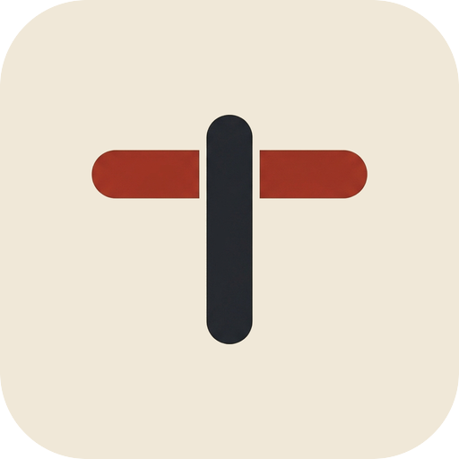

<p align="center">
  
</p>

<h2 align="center">Treadle</h2>

<p align="center">
  <em>The terminal-based workflow editor built for the AI era.</em>
</p>

<p align="center">
  <a href="#"></a>&nbsp;
  <a href="#"></a>&nbsp;
  <a href="#"></a>
</p>

---

**Treadle** is a powerful, terminal-based user interface (TUI) for designing and orchestrating workflows. Built entirely in Go, it brings modern, visual flow editing directly to your terminal. 

With an integrated AI chat, you can describe the workflow you want, and the agent will help you build it block by block without leaving your command line.

> [!WARNING]
> **Treadle is currently in active development.** Expect breaking changes and incomplete features.

## 🚀 Getting Started

### Install

On Linux or macOS:

```bash
curl -fsSL https://github.com/heddlehq/Treadle/releases/latest/download/install.sh | sh
```

On Windows, in PowerShell:

```powershell
irm https://github.com/heddlehq/Treadle/releases/latest/download/install.ps1 | iex
```

Run the same command to update. Set `TREADLE_VERSION=0.1.0` to install a specific version, or `TREADLE_HOME` to install somewhere else.

Then run `treadle`, and connect it to your [Heddle](https://github.com/heddlehq/Heddle) server. `treadle --version` prints the version you have.

### Build from source

You need the Go version in [`go.mod`](go.mod).

```bash
git clone https://github.com/heddlehq/Treadle.git
cd Treadle
go run ./cmd/treadle
```

## 🤖 Agent

The chat in the editor talks to the MCP server of your Heddle instance, and the server does the rest: it answers with the LLM configured there, and can read, create and edit your flows. Treadle asks you before running one. It sits next to the canvas, and anything you type in the workflow list that isn't a command goes to it, about the selected workflow.

There's nothing to set up here. The provider and its key belong to the server.

## 📦 Releasing

The [`VERSION`](VERSION) file is the only place the version is written down, and it's built into the binary.

1. Change `VERSION` on `main`.
2. Tag that commit: `git tag v$(cat VERSION) && git push origin v$(cat VERSION)`.

The tag builds and tests every platform, including a real run of the install scripts, and then publishes the GitHub release. The release fails if the tag doesn't match `VERSION` or isn't on `main`.

## 🤝 Community & Contributing

We believe in building in public. Join our community to discuss ideas, track our vision, or help us build:

- **Contributing**: Contributions are welcome! Since the project is in early development, please open an issue first to discuss your idea.
- **Discord Server**: Real-time chat and support in our [Discord Server](https://discord.gg/7zjnpna239).

## License

Treadle is open-source software licensed under the [MIT license](LICENSE).
